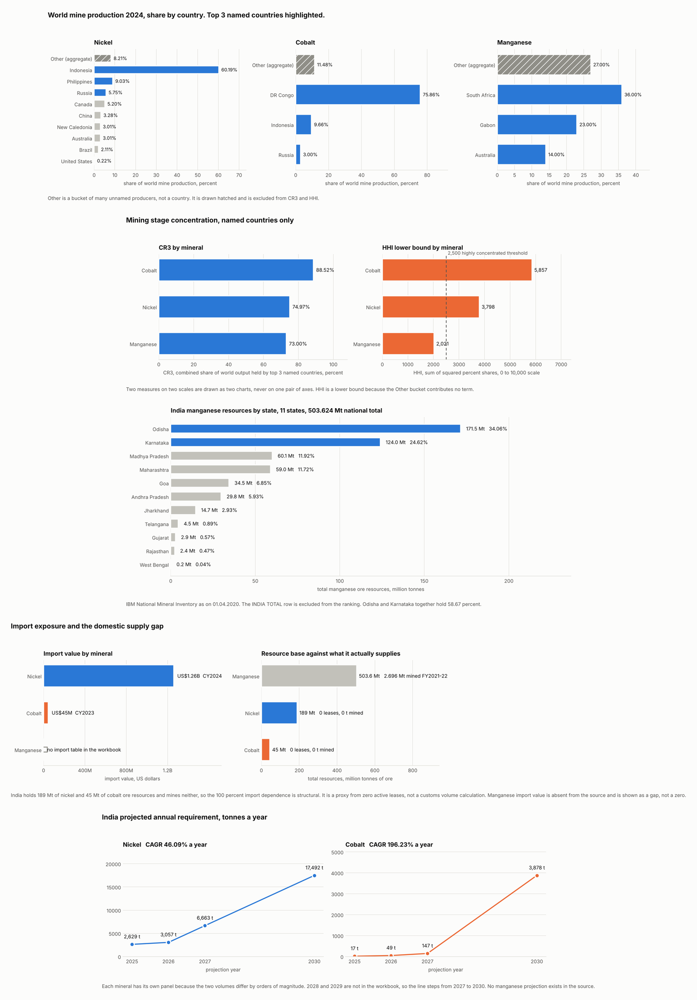
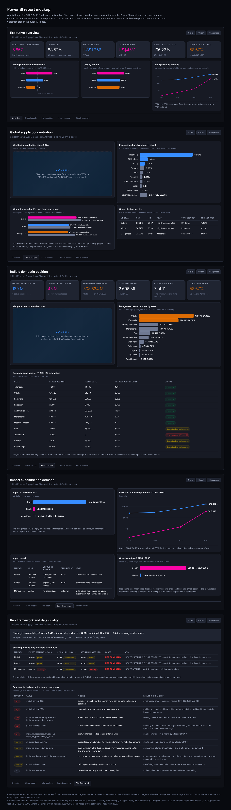

# Critical Minerals Supply-Chain Risk Analytics: India's Ni-Co-Mn Exposure

A SQL first analysis of India's exposure on three battery and steel critical minerals:
nickel, cobalt and manganese. SQLite does the ranking, the joining, the window function
work and the concentration metrics. Python and Pandas handle the growth rates, the risk
framework and an independent recomputation of the concentration metrics as a cross check.
Matplotlib builds a self contained dashboard, and the same analysis is delivered a second
time as a Power BI star schema with a five page report spec. There is no machine learning
in this project and none is needed, because every question here is a measurement question
rather than a prediction question.



`dashboard.html` is a single self contained file with no CDN calls, so it opens offline
and follows the system light or dark setting. The image above is a static preview of it,
and `docs/Critical_Minerals_Dashboard.pdf` is the printable version.

The governing rule of the project is that no number is invented. Every figure traces to a
cell in the source workbook or to arithmetic performed on workbook cells. Where the data
does not support a figure, the gap is published as a gap instead of being filled with an
estimate. That rule is what blocks the Strategic Vulnerability Score from being computed,
and the decision not to compute it is the single most important analytical result in
this repository.

---

## Headline findings

**Mining is concentrated, cobalt most of all.** On 2024 world mine production, counting
only named producer countries, cobalt has a CR3 of 88.52 percent and an HHI of 5,857.
Nickel sits at 74.97 percent and 3,798. Manganese is the least concentrated of the three
at 73.00 percent and 2,021. The US DOJ and FTC call a market highly concentrated above an
HHI of 2,500, so cobalt and nickel clear that line roughly twice and one and a half times
over. All three HHI values are lower bounds, for the reason set out under Methodology.

**India's nickel and cobalt position is structural, not cyclical.** The National Mineral
Inventory records 189 Mt of nickel ore resources and 45 Mt of cobalt ore resources, and
zero active mining leases for both. A resource base that is not being mined supplies
nothing. Against that, India imported US$1.26 billion of nickel in CY2024 and US$45
million of cobalt in CY2023.

**Demand is about to move faster than supply can respond.** Projected domestic
requirement for cobalt grows from 17 t in 2025 to 3,878 t in 2030, a CAGR of 196.23
percent a year. Nickel grows from 2,629 t to 17,492 t, a CAGR of 46.09 percent. Those
rates compound against a domestic mine supply of zero.

**Manganese is the opposite story and it is the one worth paying attention to.** India
holds 503.624 Mt of manganese resources across 11 states and actually mines them, 2.696
Mt in FY2021-22. But the resource base is itself concentrated domestically: Odisha and
Karnataka alone hold 58.67 percent of it. Four of the 11 resource holding states produced
nothing in FY2021-22. Goa, Gujarat and West Bengal have no production row in the source
at all, and Jharkhand reported zero after producing 4,785 t in 2019-20. Domestic
concentration risk is a real exposure even where import dependence is not.

**My first-pass dataset's concentration figures were wrong, and the pipeline reports
it.** The workbook I assembled appends a calculated CR3 and HHI block below its country data. That
formula ranks the Other bucket as if it were a country, which produces a cobalt CR3 of 97
percent by placing an aggregate of unnamed producers second, above Indonesia. The
recomputed figure is 88.52 percent. The block is loaded into its own table and the
difference is reported per mineral rather than being quietly replaced.

**The vulnerability score is computed only once the inputs are measured.** The core
pipeline gates it because its import dependence is a proxy. The `extension/` folder adds
DGCIS customs data and computes it: cobalt 80.5, nickel 67.3, manganese 55.3, a ranking
that holds under every plus or minus 10 point weight change. India imports 61 percent of
the manganese ore it uses. See [Extension](#extension-measured-import-dependence-and-the-vulnerability-score).

---

## Data source

One workbook, `Critical_Minerals_NiCoMn_Dataset.xlsx`, carrying eight sheets. Sources are
cited inline on each sheet:

| Sheet | Content | Cited source |
|---|---|---|
| README | sheet guide and a known gap note | n/a |
| India_Mn_Resources_by_State | Mn reserves and resources by state, thousand tonnes | IBM National Mineral Inventory as on 01.04.2020 |
| India_Mn_Production_by_State | Mn ore production 2019-20 to 2021-22 | IBM Indian Minerals Yearbook, Table 4 |
| India_NiCo_Resources | Ni and Co reserves, resources, active leases | Ministry of Mines, Rajya Sabha reply, PIB Delhi 05-Aug-2024 |
| India_NiCo_Imports | Ni and Co import value | UN COMTRADE via Trading Economics (Ni, CY2024); IndexBox (Co, CY2023) |
| India_Demand_Projection | projected annual requirement 2025 to 2030 | Ministry of Mines, PIB Delhi 05-Aug-2024 |
| Global_Mining_2024 | world mine production by country, plus a CR3/HHI block | USGS Mineral Commodity Summaries 2025 and USGS derived estimates |
| Global_Refining_Shares | processing and refining share by country | USGS Global Maps of Critical Mineral Production 2023, Fig. 2 |

### Loading rules

Every sheet carries a title in row 1, a source note in row 2, a blank row 3 and the real
header in row 4, so every read uses `header=3`. README is skipped. Beyond that, five
cleaning rules are applied in `load_data.py` and each one exists because the raw sheet
would otherwise produce a wrong answer.

1. **The CR3/HHI summary block in Global_Mining_2024 is not loaded as country rows.**
   The sheet appends a calculated concentration table below the country data. Its rows
   carry a mineral name in the first column, so a naive read turns `Nickel, 0.774282`
   into a country called 0.774282. The filter keeps a row only when the mineral is one of
   the three, the country value is genuine text and production is numeric. The summary
   block is loaded separately into `global_mining_concentration_workbook` so the
   workbook's own figures can be compared against the recomputed ones rather than
   silently discarded.

2. **Aggregate rows are tagged, not deleted.** `WORLD TOTAL` and `Other` stay in
   `global_mining_2024` with `row_type` set to `world_total` and `other_bucket`, because
   the world total is the denominator the workbook itself uses for every share. Rankings
   filter on `row_type = 'country'`. The same applies to `INDIA TOTAL` and `India
   (Total)`, which are tagged `national_total` and excluded from every state ranking
   while remaining available as a reconciliation check.

3. **Percentages are normalised to a 0 to 100 scale on load.** The workbook stores shares
   as fractions that are merely formatted as percent, so Odisha appears as 0.340587.
   Every percentage column is multiplied by 100 at load time, which keeps the SQL free of
   scaling arithmetic.

4. **Non numeric cells stay non numeric.** The manganese row in Global_Refining_Shares
   holds the sentence `Not in source map - needs separate lookup` rather than a number.
   It is kept verbatim in `refining_share_raw`, the numeric column is left NULL, and an
   `is_numeric` flag drives every downstream filter. Coercing that cell to 0 would have
   produced a manganese refining concentration of zero, which is the opposite of what the
   source says.

5. **Units are made explicit in column names.** `_kt` for thousand tonnes, `_t` for
   tonnes, `_mt` for million tonnes, `_usd` for US dollars, `_pct` for percent. The
   manganese resource sheet is in thousand tonnes and the production sheet is in tonnes,
   so a join between them without unit handling is wrong by a factor of 1,000.

---

## Schema

Eight tables in `critical_minerals.db`, printed by `load_data.py` at every run. Seven
carry source data from the seven data sheets. The eighth holds the workbook's own
calculated CR3/HHI block, kept separate so its figures can be audited rather than
inherited.

```
global_mining_2024  (21 rows)
    mineral TEXT, country TEXT, production_t REAL,
    share_of_world_pct REAL, row_type TEXT

global_mining_concentration_workbook  (3 rows)
    mineral TEXT, cr3_pct_workbook REAL, hhi_workbook REAL,
    concentration_read TEXT, basis TEXT

global_refining_shares  (5 rows)
    mineral TEXT, country TEXT, refining_share_raw TEXT,
    refining_share_pct REAL, is_numeric INTEGER

india_demand_projection  (2 rows)
    mineral TEXT, demand_2025_t INTEGER, demand_2026_t INTEGER,
    demand_2027_t INTEGER, demand_2030_t INTEGER,
    cagr_2025_2030_workbook REAL, cagr_2025_2030_workbook_pct REAL

india_mn_production_by_state  (9 rows)
    state TEXT, qty_2019_20_t INTEGER, value_2019_20_rs_thousand INTEGER,
    qty_2020_21_t INTEGER, value_2020_21_rs_thousand INTEGER,
    qty_2021_22_t INTEGER, value_2021_22_rs_thousand INTEGER, row_type TEXT

india_mn_resources_by_state  (12 rows)
    state TEXT, reserves_kt INTEGER, remaining_resources_kt INTEGER,
    total_resources_kt INTEGER, share_of_india_total_pct REAL,
    row_type TEXT, total_resources_t INTEGER

india_nico_imports  (2 rows)
    mineral TEXT, year INTEGER, import_value_usd INTEGER,
    import_volume_note TEXT, source TEXT, currency TEXT, period_basis TEXT

india_nico_resources  (2 rows)
    mineral TEXT, mineral_raw TEXT, reserve_mt REAL,
    remaining_resources_mt REAL, total_resources_mt REAL,
    active_mining_leases REAL, major_states TEXT
```

Row counts worth reading: `global_mining_2024` holds 21 rows because 15 named country
rows sit alongside 3 Other buckets and 3 world totals. `india_mn_resources_by_state` holds
12 because the national total row is retained and tagged. `india_mn_production_by_state`
holds 9 for the same reason, which is 8 producing states plus the India total.

---

## Exploratory data analysis

`explore_data.py` runs after loading and before any metric is computed, because the shape
of this workbook is what dictates every cleaning rule above. It produces three artefacts
and corrects nothing, since the correcting happens at load time. This step exists to show
the evidence that the corrections were needed.

**Column profile** (`outputs/eda_column_profile.csv`) covers 51 columns across the 8
tables with type, null count, distinct count, range and a sample value. Only three
columns carry nulls and each one is expected: the share column is empty on the aggregate
rows, and the refining share is empty on the manganese row that holds text.

**Mineral coverage matrix** (`outputs/eda_mineral_coverage.csv`) asks which of the three
minerals each table actually covers. This is the check that found the gaps:

```
mineral                      Nickel Cobalt Manganese
global_mining_2024              yes    yes       yes
global_refining_shares          yes    yes        NO
india_demand_projection         yes    yes        NO
india_mn_production_by_state     NO     NO       yes
india_mn_resources_by_state      NO     NO       yes
india_nico_imports              yes    yes        NO
india_nico_resources            yes    yes        NO
```

Manganese is absent from 4 of the cross mineral tables. That single matrix explains why
there is no manganese import dependence, no manganese refining share and no manganese
demand projection anywhere downstream, and it is the reason the vulnerability score is
blocked for that mineral.

**Quality findings** (`outputs/eda_quality_findings.csv`) lists 10 problems found in the
raw workbook, each with live evidence pulled from the database rather than asserted, the
impact if it went unhandled, and the rule that handles it. Five are high severity: the
summary block disguised as country rows, aggregate rows mixed in with real ones in two
places, a text sentence sitting in a numeric column, and the unit mismatch between the
two manganese tables.

---

## SQL

All five queries live in one file, `sql/critical_minerals_analysis.sql`, separated by
`-- @query: <name>` marker comments. `run_sql.py` splits on those markers and executes
each section, so one file still produces one named CSV per query into `outputs/`. The
markers are ordinary SQL comments, so the same file opens and runs section by section in
DB Browser for SQLite, DBeaver or the sqlite3 shell.

### Query 1: country production rank

Ranks producer countries within each mineral using
`RANK() OVER (PARTITION BY mineral ORDER BY production_t DESC)` and computes share with
`SUM() OVER (PARTITION BY mineral)`. The Other bucket and the world total are excluded
from the ranking.

The query returns two share columns on purpose, because excluding Other from the ranking
and excluding it from the denominator are two different decisions:

- `share_of_named_pct` is the `SUM() OVER` basis. The named countries in the ranking sum
  to 100 percent. It answers how output is divided among the countries we can name.
- `share_of_world_pct` divides the same production by the workbook world total, which
  still contains Other. It answers what fraction of global supply a country actually
  controls, and it is the basis used for CR3 and HHI in `analysis.py`.

Reporting only the first would overstate every country's position by silently deleting
the unnamed producers from the world. Reporting both keeps the SQL layer and the Python
layer reconciled to the same arithmetic.

### Query 2: import dependence

A CTE named `domestic_supply` reads `india_nico_resources` and sets domestic mine
production to 0 wherever `active_mining_leases = 0`, then joins it to
`india_nico_imports`. Where domestic production is zero and imports are positive, import
dependence is 100 percent.

**This is a proxy and the output says so in its own column.** `dependence_method` reads
`PROXY: derived from zero active mining leases, not from customs volume over apparent
consumption` on every row. The workbook has no customs volume series for nickel and only
an approximate note for cobalt, so a true dependence ratio of imported volume over
apparent consumption cannot be built from it. What can be defended is the structural
claim: a country with a resource base and zero active mining leases has no domestic mine
supply, so its supply is entirely imported.

Manganese is carried as an explicit `UNION ALL` gap row rather than being left out. It
reports `DATA GAP: the workbook contains no manganese import table, so no dependence
figure is computed`, and it notes that India does mine manganese domestically, so
reusing the zero supply assumption would be wrong rather than merely unsupported.

### Query 3: state manganese resource rank

Ranks the 11 manganese resource states with `RANK() OVER (ORDER BY total_resources_kt
DESC)` and computes share against `SUM(...) OVER ()`. The INDIA TOTAL row is excluded by
`row_type`. A running `cumulative_share_pct` is built with
`ROWS BETWEEN UNBOUNDED PRECEDING AND CURRENT ROW` in a second CTE, because SQLite will
not accept a window aggregate nested inside another window aggregate.

The query carries a `total_reconciliation` column that compares the recomputed state sum
against the workbook INDIA TOTAL. It returns `match` on all 11 rows: 503,624 thousand
tonnes either way.

### Query 4: resource against production

Joins the resource table to the FY2021-22 production table and computes
`resource_t_per_t_production`, the tonnes sitting in the resource base for each tonne
actually mined. Resources are converted from thousand tonnes to tonnes first so both
sides share a unit.

A LEFT JOIN keeps all 11 resource states, and `production_status` labels each one rather
than dividing by zero:

- `producing` for the 7 states with FY2021-22 output
- `no_production_row` for Goa, Gujarat and West Bengal, which hold resources but appear
  nowhere in the production table for any year
- `zero_production` for Jharkhand, which is in the production table but reported 0 t in
  FY2021-22 after 4,785 t in 2019-20

The ratio is NULL for all four, never zero and never a divide by zero error. Telangana
has the highest ratio at 431.5 tonnes of resource per tonne mined, then Odisha at 334.6
and Karnataka at 326.2. Madhya Pradesh is the most intensively worked at 70.7.

### Query 5: CR3 and HHI in SQL

Computes CR3 and HHI per mineral in SQL, using `RANK()` and `ROW_NUMBER()` over a shares
CTE and aggregating the squared shares with `SUM()`. `analysis.py` computes the same two
metrics independently in Pandas and the pipeline asserts that the two layers agree on
every mineral, which they do to two decimal places. That cross check is written to
`outputs/metric_sql_python_cross_check.csv`.

Two ranking functions are used on purpose. `RANK` is reported because it is the honest
competition rank and exposes ties, and nickel genuinely has one at position 6 where
Australia and New Caledonia are both on 110,000 t. `ROW_NUMBER` draws the top 3 cut, so a
tie on the third position can never pull a fourth country into CR3.

The query also joins the workbook's own CR3/HHI block and reports the difference per
mineral in the same result set, which is how the source error below surfaces without
anyone having to look for it.

---

## Methodology

### CR3 and HHI, and why the Other bucket is excluded

CR3 is the combined share of world mine production held by the top three named countries.
HHI is the sum of squared percentage shares on the 0 to 10,000 scale. Both use the
workbook world total as the denominator, which is the same basis the workbook uses for
its own share column. Both are computed twice, once in `sql/05_cr3_hhi_concentration.sql`
and once in `analysis.py`, and the pipeline asserts the two agree.

The Other bucket is excluded from the CR3 numerator and from every HHI term, because
Other is an aggregate of many unnamed producers rather than a country. Treating it as one
producer squares a sum instead of summing squares, which overstates concentration. The
cost of excluding it is that those real producers contribute nothing, so:

**The HHI reported here is a lower bound on true mining concentration.** Splitting Other
into its constituent countries could only add positive terms. The size of the omission is
published alongside every value: Other holds 8.21 percent of world nickel output, 11.48
percent of cobalt and 27.00 percent of manganese.

The workbook's own CR3/HHI block sorts Other in with the countries and so counts it as a
single producer. The recomputed figures are reported against it in
`outputs/metric_concentration_vs_workbook.csv` rather than quietly replacing it:

| Mineral | CR3 named | CR3 workbook | HHI named | HHI workbook |
|---|---|---|---|---|
| Nickel | 74.97 % | 77.43 % | 3,798 | 3,865 |
| Cobalt | 88.52 % | 97.00 % | 5,857 | 5,989 |
| Manganese | 73.00 % | 86.00 % | 2,021 | 2,750 |

The cobalt and manganese CR3 gaps are the clearest cases. The workbook's 97 percent for
cobalt is built by ranking the Other bucket second, above Indonesia. That is an artefact
of the bucket, not a fact about the cobalt market.

### Demand CAGR

CAGR 2025 to 2030 is `(value_2030 / value_2025) ** (1/5) - 1`, five compounding periods
between the endpoints. Cobalt returns 196.23 percent a year on 17 t to 3,878 t, nickel
46.09 percent on 2,629 t to 17,492 t. Both reproduce the workbook's own stored CAGR to
within 1e-6, which the pipeline asserts in `matches_workbook_cagr`.

The 2028 and 2029 values are not in the source, so the demand chart steps from 2027 to
2030 rather than interpolating a line through years that do not exist. There is no
manganese demand projection in the workbook, so none is shown anywhere.

### Strategic Vulnerability Score: gated in the core pipeline, computed in the extension

The intended composite is:

```
score = 0.40 * import_dependence_pct
      + 0.35 * (mining_hhi / 100)
      + 0.25 * refining_leader_share_pct
```

All three inputs are normalised to a 0 to 100 scale before weighting, which is why the
HHI is divided by 100. The weighting puts import dependence first because it is the
exposure India can least control, mining concentration second because it drives supply
shock probability, and refining third because it is a chokepoint that can be routed
around on a longer timescale than a mine can be opened.

The gate is that all three inputs must exist and be complete for a mineral.
**No mineral clears it, so no score is computed for any mineral.**

| Mineral | Import dependence | Mining HHI / 100 | Refining leader | Score |
|---|---|---|---|---|
| Nickel | 100.00 (proxy) | 37.98 (lower bound) | 56.00 (partial) | not computed |
| Cobalt | 100.00 (proxy) | 58.57 (lower bound) | 80.00 (partial) | not computed |
| Manganese | no data | 20.21 (lower bound) | no data | not computed |

The reasons differ by mineral and both are recorded in the output:

- **Nickel and cobalt** have a value in all three slots, but the import dependence is the
  structural proxy described above rather than a measured ratio, and the refining share
  comes from a USGS map that plots only countries crossing 5 percent of world processing.
  A leader share drawn from a partial country list is not a concentration measurement.
- **Manganese** is missing two of the three inputs outright. There is no import table and
  no refining figure. The workbook's own README flags the manganese refining row as
  partial coverage and not a full HHI base.

Publishing a weighted number on those inputs would present an assumption as a
measurement. A reader seeing `Cobalt: 79.2` would reasonably take it as measured, and
nothing in the number itself would warn them that two of its three components are
estimates of different quality. The framework, the weights and the normalised inputs are
all published so the score can be computed the moment real customs data and a complete
refining country list are added. The empty score column is the honest output of the core
pipeline; the extension below adds the customs data and computes it.

---

## Extension: measured import dependence and the vulnerability score

`extension/` replaces the lease-based proxy with official customs data and computes the
score. Run it after the core pipeline: `python extension/import_dependence_v2.py`.
Full sources, method and limits are in [`extension/README.md`](extension/README.md).

**Data added.** India's imports and exports by HS code and country, value and quantity,
FY2024-25 and FY2025-26, from DGCIS via
[tradestat.commerce.gov.in](https://tradestat.commerce.gov.in/eidb/commodity_wise_all_countries_import)
(17 HS codes). Domestic manganese ore production of 3.8 Mt in FY2024-25 from the Ministry
of Mines. China's 95 percent share of battery-grade manganese sulphate (2024) from the
[US International Trade Commission](https://www.usitc.gov/sites/default/files/publications/332/executive_briefings/ebot_guberman_manganese_for_ev_batteries.pdf).

| Metal | Import dependence, FY2024-25 | India's supplier HHI | Score | Rank |
|---|---|---|---|---|
| Cobalt | 100% (548 t unwrought cobalt imported, no domestic mining) | 1,687 | 80.5 | 1 |
| Nickel | 100% (35,707 t unwrought nickel imported, no domestic mining) | 1,215 | 67.3 | 2 |
| Manganese | 61.3% (6.01 Mt ore imported against 3.80 Mt mined) | 2,000 | 55.3 | 3 |

- **India imports more manganese ore than it mines**, so even the metal India produces is
  61 percent import dependent by weight.
- **India's own supplier list is far less concentrated than world mining.** Cobalt mining
  HHI is 5,857, but India's import-source HHI is 1,687, because India buys refined products
  from many refiners and traders. The concentration risk sits upstream.
- **The ranking is robust.** Moving any weight up or down 10 points, or using the HHI upper
  bound, never changes the order cobalt, nickel, manganese.

Limits: tonnes are gross weight, not metal content; trading hubs (Singapore, UAE, Hong
Kong) may understate true origin concentration; cobalt export rows look misclassified and
are not used; refining shares are leader shares from 2023 and 2024.

---

## Limitations

1. **Import dependence in the core pipeline is a structural proxy, not a customs
   calculation.** It is derived from zero active mining leases. The extension measures it
   for manganese (61.3 percent) and confirms nickel and cobalt volumes from customs data.
2. **HHI is a lower bound for all three minerals.** The Other bucket contributes no term.
   Manganese is affected most, with 27 percent of world output unnamed.
3. **Refining coverage is partial.** The USGS source lists only countries above 5 percent
   of world processing, so the refining shares are leader shares on an incomplete list and
   no refining HHI can be built. Manganese has no refining figure at all.
4. **Manganese has no import data in the workbook**, so the core pipeline flags it as a
   gap rather than assuming zero. The extension fills it from DGCIS customs data.
5. **Resource and production data are from different dates.** Resources are as on
   01.04.2020 and production is FY2021-22, so `resource_t_per_t_production` compares a
   2020 stock against a 2022 flow.
6. **Import values are indicative.** The workbook states they are order of magnitude
   figures, not customs audited, and the two minerals are on different calendar years,
   nickel CY2024 and cobalt CY2023, so they are not strictly comparable to each other.
7. **The GSI newly explored resources are not included** in the headline resource
   figures. The workbook notes an additional 4.7 Mt of nickel ore and 275 t of cobalt on
   top of the NMI base, which this analysis leaves separate rather than adding to a
   differently dated inventory.
8. **Production value columns are in Rs thousand** and are loaded but unused, since
   mixing rupee values with US dollar imports without an explicit exchange rate and date
   would create a false comparison.

---

## Power BI

The same analysis is delivered a second time as a Power BI model and a five page report.
Everything needed to build it is in `powerbi/`.



That image is `powerbi/mockup/report-mockup.html`, a static build target rendered from
the exported tables. Every number in it is the number the Power BI model should produce,
so it doubles as a specification and as a check. Map visuals appear as labelled
placeholders rather than faked, because an invented map would be the one thing on the
page that is not real data.

### What is in powerbi/

| Path | What it is |
|---|---|
| `Critical_Minerals_Report.pbit` | Power BI template: the model plus the full five page report |
| `Critical_Minerals_Model.pbit` | the same model with one empty page, for building visuals by hand |
| `Critical_Minerals_PowerBI.xlsx` | all 17 tables, one sheet each, for a single click import |
| `data/*.csv` | the same 17 tables as CSVs |
| `theme/critical-minerals-vibrant.json` | importable Power BI theme, dark canvas and vibrant palette |
| `DAX_measures.md` | every measure, copy paste ready, with formatting settings |
| `BUILD_GUIDE.md` | load, model, theme, then a visual by visual spec for five pages |
| `mockup/report-mockup.html` | the build target shown above |
| `../docs/Critical_Minerals_Report_Mockup.pdf` | the mockup's five pages printed to PDF (an HTML mockup, not an export from Power BI) |

### The model is reshaped, not re-exported

`build_powerbi_export.py` does not hand Power BI the analysis tables as they stand. The
analysis database is shaped for SQL, where an aggregate row sitting beside a detail row is
handled by a `WHERE` clause. Power BI has no `WHERE` clause between a user and a chart, so
anything at the wrong grain inside a fact table eventually gets double counted on a
visual. Three changes follow:

1. **Aggregates are split out by grain.** Named countries live in `fact_world_mining`
   while the world total and the Other bucket live in `ref_world_totals`. States live in
   `fact_mn_resources` while the national total lives in `ref_india_totals`. Dragging a
   country onto a chart can no longer pull in the world. This is the decision worth
   explaining in an interview, because it is the difference between building a model and
   dragging fields onto a canvas.
2. **Year columns are unpivoted into rows.** The workbook holds production and demand as
   one column per year, which cannot drive a time axis or a year slicer. Both come out
   long, 24 rows of production and 8 of demand.
3. **Dimensions are separated and keyed.** One `dim_mineral` drives nine fact and
   reference tables, so a single slicer filters the whole report.

### The reference tables are a test harness

`ref_concentration` carries the CR3 and HHI values that this project's SQL layer and
Python layer both produce and agree on. The DAX in `DAX_measures.md` is written to
reproduce them from the raw facts, and step 9 of the build guide is a validation visual
whose two check columns must read zero. If the DAX disagrees with the reference, the DAX
is wrong. A model that cannot be checked against a known answer is a model nobody should
trust, including the person who built it.

### The palette is vibrant and checked

Nickel is electric blue `#378DFF`, cobalt is hot magenta `#FA04A6`, manganese is burnt
orange `#DB6B04`. The eight theme colours were generated at a fixed perceptual lightness
against the dark canvas and then run through a colourblind separation check as a set, so
the palette is vivid by construction rather than by guesswork. Colour follows the mineral
on every page and never the chart position, so a slicer that drops one mineral cannot
repaint the other two.

### Why .pbit and not .pbix

A .pbix is a compiled binary. Its model part is a serialized Analysis Services database
that only Power BI itself can write, so a .pbix cannot honestly be produced outside Power
BI Desktop. A .pbit is the open equivalent: the same OPC container, but the model travels
as TMSL JSON and the report as layout JSON, both of which are text. Power BI Desktop opens
a .pbit, builds the model, runs the queries and hands back a live report that saves as
.pbix in one step.

`build_pbit.py` writes both templates from the same model. The data rows are embedded in
the Power Query expressions as literals, so the template opens on any machine with no
file path, no gateway and no broken refresh, and the whole model is 124 rows. The build
guide shows the two line change that repoints any table at the Excel workbook instead.

Power BI cannot be run on the machine that generated these files, so the build checks
everything it can mechanically and says so rather than claiming the file is tested: the
container and its encodings, that the TMSL and every embedded JSON string parse, that
every DAX reference, relationship, visual field and filter resolves against the model,
and that the embedded row counts match the export table for table. Two templates are
shipped for the same reason. The model half is plain TMSL and is the lower risk of the
two, so if the report template ever refuses to open, the model template still delivers
all 18 tables, 14 relationships and 32 measures and the build guide covers laying out the
visuals by hand from there.

### PDF versions

Both dashboards are also exported to PDF, in `docs/`:

| File | What it is |
|---|---|
| `Critical_Minerals_Report_Mockup.pdf` | the five page Power BI build target (HTML mockup), one landscape sheet per page, plus a sources sheet |
| `Critical_Minerals_Dashboard.pdf` | the matplotlib dashboard, A4 portrait |

`build_pdf.py` prints both from the HTML through headless Chrome, so a PDF and its live
page can never drift apart. It measures each report page in the browser first and gives
every sheet its own height, because a PDF may carry a different page size per page. The
alternative, one uniform sheet, forces a choice between cropping the tallest page and
padding every other one, and a cropped table in a PDF looks exactly like a complete table
with fewer rows.

### Running it on a Mac

Power BI Desktop has no macOS build. Either run Windows through Parallels, Boot Camp or a
cloud VM, or upload `Critical_Minerals_PowerBI.xlsx` to `app.powerbi.com` and build in the
browser. The build guide marks the steps that are Desktop only, which are mainly the
one click theme import and a few formatting panes.

---

## Verification

`verify_expectations.py` checks every headline figure and prints PASS or FAIL per check.
Current state: **114 of 114 checks pass.** That covers the state rankings, the resource
and import figures, both concentration metrics in both layers, the SQL against Python
agreement, the demand CAGRs, the refining leaders, the vulnerability gate, the zero
division handling in query 04, the presence of every deliverable, and the Power BI export,
including that no aggregate row leaked into a fact table and that the exported
concentration figures match the rest of the pipeline, and the two Power BI templates,
including that every reference inside the model and the report resolves and that the
embedded rows match the export, and the two PDF exports.

One rounding note is worth recording. Odisha plus Karnataka is 58.6747 percent exactly.
Adding the two rounded shares gives 34.06 + 24.62 = 58.68, while rounding the exact sum
gives 58.67. Both describe the same quantity and both round to 59 percent, which is the
figure that belongs on a resume.

---

## How to run

```bash
pip install -r requirements.txt

python load_data.py          # workbook to SQLite, prints the schema with row counts
python explore_data.py       # column profile, mineral coverage, quality findings
python run_sql.py            # runs all five .sql files, writes a CSV per query
python analysis.py           # full pipeline: load, EDA, SQL, metrics, dashboard, Power BI
python verify_expectations.py
python build_powerbi_export.py   # star schema CSVs and the import workbook
python build_powerbi_mockup.py   # the Power BI build target
python build_pbit.py             # the two .pbit template files
python build_pdf.py              # both dashboards as PDF
python make_preview.py           # rebuilds both README images
```

`analysis.py` runs the whole chain on its own, so it is the single entry point.

---

## File map

```
critical-minerals/
  README.md
  requirements.txt
  Critical_Minerals_NiCoMn_Dataset.xlsx     source workbook
  critical_minerals.db                      SQLite database, 8 tables
  load_data.py                              sheets to SQLite with the cleaning rules
  explore_data.py                           column profile, coverage matrix, quality findings
  run_sql.py                                executes sql/*.sql, writes outputs/*.csv
  analysis.py                               CAGR, vulnerability framework, cross checks
  build_dashboard.py                        renders dashboard.html
  build_powerbi_export.py                   SQLite to a Power BI star schema
  build_powerbi_mockup.py                   renders the Power BI build target
  build_pbit.py                             packages the .pbit templates and checks them
  build_pdf.py                              prints both dashboards to PDF
  pbit_model.py                             TMSL model, embedded M data, DAX measures
  pbit_report.py                            five page report layout
  make_preview.py                           composes both README images
  verify_expectations.py                    114 checks against the expected figures
  critical_minerals_analysis.ipynb          notebook walkthrough, outputs included
  dashboard.html                            single file dashboard, no external assets
  docs/
    dashboard-preview.png                   matplotlib dashboard preview
    powerbi-report-mockup.png               five page Power BI build target
    Critical_Minerals_Report_Mockup.pdf     the five page report mockup as PDF
    Critical_Minerals_Dashboard.pdf         the matplotlib dashboard as PDF
  powerbi/
    Critical_Minerals_Report.pbit           template, model plus five page report
    Critical_Minerals_Model.pbit            template, model only
    Critical_Minerals_PowerBI.xlsx          17 tables, one sheet each
    BUILD_GUIDE.md                          load, model, theme, five page visual spec
    DAX_measures.md                         every measure plus formatting
    theme/critical-minerals-vibrant.json    importable dark vibrant theme
    mockup/report-mockup.html               the build target
    data/                                   the 17 tables as CSVs
  sql/
    critical_minerals_analysis.sql          all five queries, comment separated
  extension/
    README.md                               sources, method, results and limits
    import_dependence_v2.py                 measured dependence, supplier HHI, score, sensitivity
    reference_inputs.csv                    domestic production and refining shares, with sources
    dgcis_raw/                              customs data as pulled from tradestat
    outputs_v2/                             five result CSVs
  outputs/
    01_country_production_rank.csv
    02_import_dependence.csv
    03_state_mn_resource_rank.csv
    04_resource_vs_production.csv
    05_cr3_hhi_concentration.csv
    eda_column_profile.csv
    eda_mineral_coverage.csv
    eda_quality_findings.csv
    metric_cr3_hhi.csv
    metric_concentration_vs_workbook.csv
    metric_sql_python_cross_check.csv
    metric_demand_cagr.csv
    metric_vulnerability_inputs.csv
    headline_numbers.txt
```
